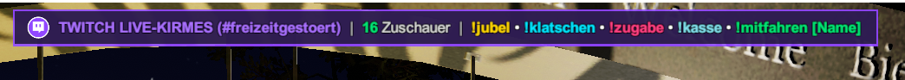

# 🎡 Fairground Online — Twitch Live Integration Mod

[-9146FF?style=for-the-badge&logo=twitch&logoColor=white)](#-kein-twitch-login--kein-passwort-nötig)

### Verwandle deine Kirmes in ein interaktives Twitch-Live-Event!
**Deine Twitch-Zuschauer werden zu echten Parkbesuchern & Mitarbeitern auf deiner Kirmes.**  
Sie jubeln in Fahrgeschäften mit, bedienen Kassenhäuschen und sprechen live über 3D-Sprechblasen!

---

## 🔒 KEIN Twitch-Login & KEIN Passwort nötig!
> 💡 **100 % sicher & kinderleicht:**  
> Du musst dich **nicht** mit deinem Twitch-Konto anmelden, kein Passwort eingeben und keine unsicheren Token erstellen!  
> **Einfach nur deinen Twitch-Kanalnamen eintragen — FERTIG!** Die Mod liest den öffentlichen Chat völlig anonym mit.

---

## 📸 Eindrücke aus dem Spiel (In-Game Screenshots)

### 🎟️ Echte Twitch-Rollen, Kassenkräfte & 3D-Icons

  
  

<i>Links: Ein Moderator arbeitet live an der Kasse mit offiziellem Mod-Schwert & Sub-Stern • Rechts: Zuschauer fahren in Fahrgeschäften mit</i>

  

### 🎯 Radar-Tracker (Zuschauer durch Wände finden) & Info-Header

  
   
  

<i>Oben: Radar-Markierung mit Entfernungs-Pfeil (167m) • Unten: Der elegante Twitch-Info-Header direkt im Spiel</i>

---

## 🌐 Das Live Web-Dashboard (Steuerung im Browser)

Über `http://127.0.0.1:48888` hast du während des Spielens die volle Kontrolle auf deinem zweiten Monitor, Tablet oder Smartphone:

  
    
  

- **Live-Umschaltung:** Kanal live im laufenden Spiel wechseln ohne Neustart!
- **1-Klick-Zuweisung:** Klicke bei einem Zuschauer auf `Kasse`, `Chip-Sammler` oder `Bude`, um ihn sofort an seinen Wunsch-Arbeitsplatz zu beamen.
- **Radar-Aktivierung:** Finde jeden Zuschauer auf dem gesamten Kirmesplatz mit Live-Entfernungsanzeige.
- **Eigene Durchsagen:** Blende goldene VIP-Laufbänder mit eigenen Texten im Spiel ein.

---

## ✨ Alle Features auf einen Blick

- 🏷️ **3D-Namensschilder:** Bis zu 2.000 Peeps können gleichzeitig Namen deiner Chatter tragen.
- 🛡️ **Echte Twitch-Badges:** Zeigt Mod-Schwerter, VIP-Diamanten und Sub-Sterne als 3D-Symbole über den Köpfen.
- 🎟️ **Mitarbeiter-System:** Teilt Moderatoren und VIPs automatisch als Personal an Fahrgeschäften und Spielbuden ein.
- 💬 **3D-Sprechblasen:** Normale Chat-Nachrichten erscheinen als gut lesbare Sprechblase über dem Kopf der Spielfigur.
- 🙌 **Chat-Interaktionen:**
  - `!jubel` / `!handsup` ➔ Reißt im Sitz oder beim Gehen die Arme hoch!
  - `!klatschen` / `!clap` ➔ Klatscht begeistert Beifall!
  - `!zugabe` / `!schrei` ➔ Fordert lautstark Zugabe mit Sound-Effekt!
  - `!mitfahren [Name]` ➔ Steigt gezielt beim Streamer oder bei einer Attraktion ein (z. B. `!mitfahren megadance`)!
  - `!kasse`, `!chip`, `!bude` ➔ Wechselt gezielt an eine Kasse oder Spielbude.
- 🎬 **Offline VOD-Demo:** Teste die Mod jederzeit auch offline mit 885 echten Chat-Nachrichten aus dem Kirmes-Stream von *Freizeitgestoert*!

---

## 🚀 Installation (In 2 einfachen Schritten)

### 1. BepInEx Mod-Loader (Einmalig)
Falls du BepInEx noch nicht installiert hast, lade dir unser fertiges 1-Klick-Paket herunter:  
👉 **[Fairground-Online-BepInEx herunterladen & in den Spielordner entpacken](https://github.com/BlackMautz/Fairground-Online-BepInEx)**

### 2. Twitch-Mod installieren
1. Lade die neueste **`FairgroundTwitch_v1.3.0.zip`** unter **[Releases](https://github.com/BlackMautz/Fairground-Online-Twitch/releases/latest)** herunter.
2. Entpacke den Inhalt direkt in dein **Fairground Online Hauptverzeichnis** (dort, wo die `Fairground Online.exe` liegt).
3. Starte das Spiel — das Web-Dashboard öffnet sich automatisch im Browser!

---

## 💬 Community & Support (Discord)
Du hast Fragen zur Mod, suchst Mitspieler für den Multiplayer oder möchtest neue Features vorschlagen?  
Komm auf unseren offiziellen Discord-Server:  
👉 **[Hier dem Discord beitreten: discord.gg/y7XMy8Jduq](https://discord.gg/y7XMy8Jduq)**

---
*Erstellt mit Leidenschaft für die Fairground Online Community von [BlackMautz](https://github.com/BlackMautz).*
