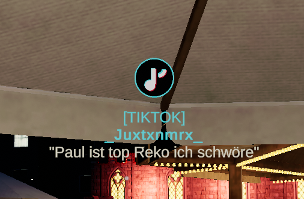
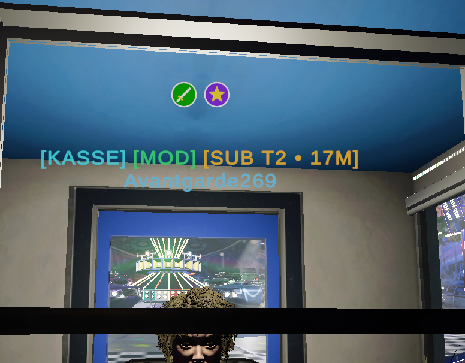
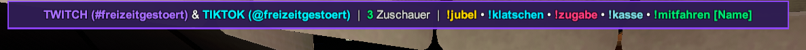
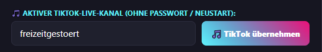
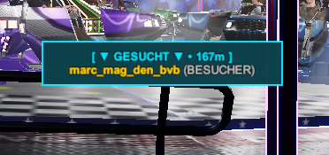
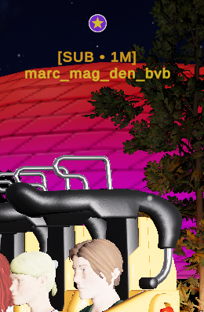
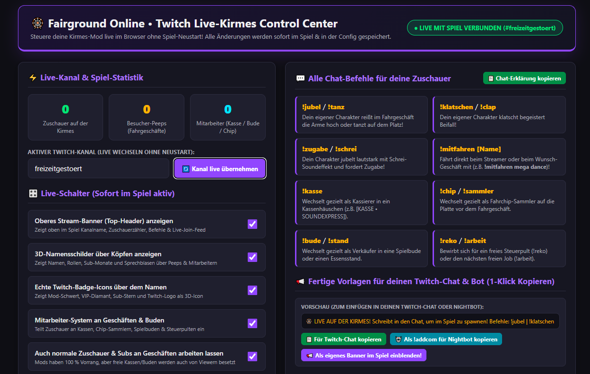
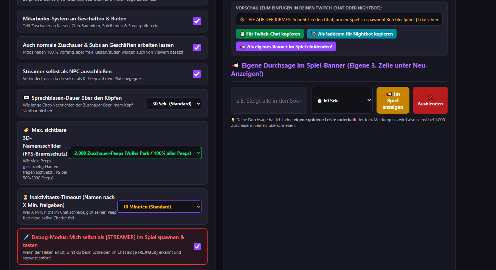
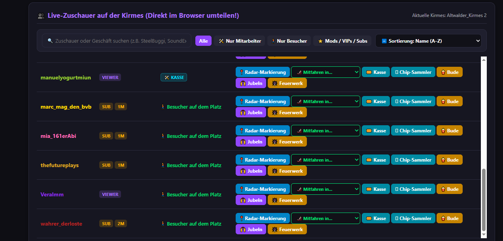

# 🎡 Fairground Online — Fairground Live (Twitch & TikTok Crowd)

<div align="center">

[](https://discord.gg/y7XMy8Jduq)
[](https://github.com/BlackMautz/Fairground-Online-Twitch/releases/latest)
[](https://www.youtube.com/watch?v=blu8RhyLMN4)
[](#-kein-login--kein-passwort-nötig-100-sicher)

### Verwandle deine Kirmes in ein interaktives Live-Event für Twitch, TikTok & deine eigene Freundesliste!
**Deine Twitch- & TikTok-Zuschauer (oder deine eigene Offline-Besucherliste) werden zu echten 3D-Parkbesuchern & Mitarbeitern auf deiner Kirmes.**  
Sie steigen aktiv in Fahrgeschäfte ein, jubeln in den Gondeln mit, bedienen Kassenhäuschen, tragen echte 3D-Badges über dem Kopf und sprechen live über Sprechblasen!

</div>

---

## 🎬 Offizielles Gameplay Demo-Video

<div align="center">

[](https://www.youtube.com/watch?v=blu8RhyLMN4)

👉 **[Hier klicken, um das Gameplay-Demo auf YouTube anzuschauen](https://www.youtube.com/watch?v=blu8RhyLMN4)** 👈  
*Erlebe die Mod live in Action: Kassen-Mitarbeiter, Kirmes-Zuschauer, 3D-Namensschilder und Chat-Aktionen!*

</div>

---

## 🔒 KEIN Login & KEIN Passwort nötig (100 % Sicher & 100 % Multiplayer-Ready)!
> 💡 **Kinderleicht & ohne Risiko:**  
> Du musst dich **weder bei Twitch noch bei TikTok anmelden**, kein Passwort eingeben und keine unsicheren Token erstellen!  
> **Einfach deinen Twitch-Kanalnamen und/oder TikTok-Namen eintragen — FERTIG!**  
> Lässt du **beide Felder leer**, startet die Mod **automatisch deine eigene Offline-Besucherliste (`custom_names.txt`)** und blendet das obere Stream-Banner im Spiel automatisch aus!  
> **Multiplayer-Ready:** Funktioniert zu 100 % auch dann, wenn du einer Lobby beitrittst, deren Host keine Mods installiert hat!

---

## ✨ Neu in diesem Update (Live-Mitfahrer, Sitzplatz-Tracking & 3D-Highlighting)

* **🎢 Live-Mitfahrer-Box („Wer sitzt gerade bei mir im Fahrgeschäft?"):**
  * Sobald du dich im Spiel in ein Steuerpult setzt (**Operator Rights aktiv**), zeigt dir das Dashboard unterhalb der Durchsage in Echtzeit **jeden einzelnen Zuschauer an, der gerade in deinem Fahrgeschäft sitzt** – inklusive **Gondel- & Sitzplatznummer** (z. B. `🎢 Gondel 2 • Sitz #5`), Namensfarbe sowie Direkt-Buttons für **🙌 Jubeln** und **📍 Radar/Highlight**!
* **🚶 Komplette Positions- & Warteschlangen-Übersicht:**
  * In der großen Zuschauer-Tabelle siehst du jetzt für jeden Besucher live auf den ersten Blick:
    * `🎢 Sitzt in: MEGADANCE (Gondel 2 • Sitz #5) ★ BEI DIR`
    * `⏳ Warteschlange: SOUNDEXPRESS` (wenn er gerade am Eingang ansteht)
    * `🚶 Bei RIESENRAD (14m)` (wenn er über den Platz schlendert)
  * Inklusive Schnellfilter-Button **`🎢 In Fahrgeschäften`**, um sofort alle aktuellen Fahrgäste auf dem gesamten Kirmesplatz zu filtern.
* **📍 Verbessertes Durch-Wände-Radar & 3D-In-Game-Highlight:**
  * Klickst du bei einem Mitfahrer oder Besucher auf **📍**, erscheint eine **pulsierende 2D-Radar-Box** (inkl. exaktem Sitzplatz & Distanz in Metern, funktioniert jetzt auch im Offline-Modus!) **UND** direkt über seinem Kopf im Fahrgeschäft leuchtet ein großes **3D-Schild `▼ [ ★ HIER BIN ICH! ★ ] ▼`** ohne Distanz-Ausblendung auf!
* **🎲 Intelligenter Auto-Header & Automatischer Offline-Modus (`custom_names.txt`):**
  * **Nur Twitch eingetragen:** Header zeigt nur `TWITCH LIVE-KIRMES (#kanal)`.
  * **Nur TikTok eingetragen:** Header zeigt nur `TIKTOK LIVE-KIRMES (@user)`.
  * **Beide eingetragen:** Header zeigt `TWITCH (#kanal) & TIKTOK (@user)`.
  * **Beide Felder leer:** Startet **automatisch die eigene Besucherliste (`BepInEx/config/custom_names.txt`)** und blendet den oberen Stream-Header sowie die grünen Einstiegs-/Join-Meldungen für ein cleanes Offline-Erlebnis komplett aus!

---

## 📸 Eindrücke aus dem Spiel (In-Game Screenshots)

<div align="center">

### 🎵 TikTok & Twitch Multistreaming & 3D-Badges
<p align="center">
  
  
</p>
<i>Links: Echter TikTok-Chatter spawnt mit schwebendem 3D TikTok-Badge über dem Kopf! • Rechts: Twitch-Moderatoren arbeiten live an Kassen</i>

<br><br>

### 👑 Das Multistream In-Game Banner & Join-Feed
<p align="center">
  
  <br><br>
  
</p>
<i>Oben: Elegantes, zentriertes Multistream-Banner mit Twitch (#kanal) & TikTok (@kanal), Live-Zuschauerzähler und Befehlen • Unten: Automatische Beitritts- & Einstiegs-Meldungen im Live-Stream</i>

<br><br>

### 🎯 Radar-Tracker (Zuschauer durch Wände & in Gondeln finden) & Fahrgeschäfte
<p align="center">
  
  <br>
  
</p>
<i>Oben: Pulsierende Radar-Markierung mit Sitzplatz- & Entfernungs-Anzeige + 3D-Highlight über dem Kopf • Unten: Zuschauer fahren aktiv in den Attraktionen mit</i>

</div>

---

## 🌐 Das Live Web-Dashboard (Steuerung im Browser ohne Neustart)

Die Mod bringt einen eigenen kleinen Webserver mit (**http://127.0.0.1:48888**), der sich beim Spielstart automatisch öffnet. Hier steuerst du alles live:

<div align="center">

<p align="center">
  
</p>

### 🎛️ Alle Funktionen auf einen Blick:
<p align="center">
  
  
</p>

</div>

* **🟣 Twitch & 🎵 TikTok Kanäle:** Direkt im Browser eintragen, wechseln oder leeren (leere Felder starten automatisch die Offline-Besucherliste).
* **🎢 Live-Mitfahrer-Anzeige (Operator Rights):** Zeigt dir alle Zuschauer inkl. Sitzplatznummer, die gerade in deinem gesteuerten Fahrgeschäft sitzen – mit 1-Klick **🙌 Jubeln** und **📍 Highlighten**!
* **👥 Zuschauer-Tabelle mit Live-Ortung:** Zeigt jeden Chatter mit Name, Plattform (`🎵 TikTok` vs `🟣 Twitch`), Rolle, exaktem Sitzplatz im Fahrgeschäft, Warteschlange oder nächster Attraktion.
* **🛠️ 1-Klick Zuweisung:** Klicke bei einem Zuschauer auf `[🎟️ Kasse]`, `[🪙 Chip]`, `[🍿 Bude]` oder `[🎢 Mitfahren in...]`, um ihn sofort dorthin zuzuweisen!
* **📍 Durch-Wände-Radar & 3D-Highlight:** Markiere einen Zuschauer – ein pulsierendes Radar-Zeichen und ein großes `★ HIER BIN ICH! ★`-Banner über seinem Kopf zeigen dir sofort, in welcher Gondel er sitzt!

---

## 💬 Alle Chat-Befehle für deine Zuschauer

Deine Zuschauer auf **Twitch** und **TikTok** können folgende Befehle in deinen Chat schreiben:

| Befehl | Alternative | Funktion |
| :--- | :--- | :--- |
| `!jubel` | `!tanz`, `!handsup` | Hebt im Fahrgeschäft begeistert die Arme hoch oder jubelt auf dem Platz! |
| `!klatschen` | `!clap` | Klatscht begeistert Beifall für die Show oder Fahrt! |
| `!zugabe` | `!schrei`, `!again` | Jubelt lautstark mit Schrei-Soundeffekt und fordert Zugabe! |
| `!mitfahren [Name]` | `!gast [Name]` | Steigt gezielt in ein Fahrgeschäft ein (z.B. `!mitfahren megadance`, `!mitfahren soundexpress`, `!mitfahren riesenrad`) |
| `!frau` / `!man` | `!w` / `!m` | Wechselt das 3D-Charaktermodell gezielt auf einen weiblichen oder männlichen Kirmes-Besucher |
| `!kasse` | `!kassierer` | Wechselt gezielt als Kassierer ins Kassenhäuschen |
| `!chip` | `!sammler` | Besetzt die Fahrchip-Sammler-Platte vor dem Fahrgeschäft |
| `!bude` | `!stand` | Verkauft Snacks & Lose in Spielbuden und Imbissen |
| `!reko` | `!arbeit` | Besetzt ein freies Steuerpult (`!reko`) oder den nächsten freien Job (`!arbeit`) |

---

## ⚙️ Installation

1. Installiere zuerst das **[Fairground-Online-BepInEx Framework](https://github.com/BlackMautz/Fairground-Online-BepInEx)**.
2. Lade die neueste **[Fairground Live Release ZIP](https://github.com/BlackMautz/Fairground-Online-Twitch/releases/latest)** herunter.
3. Entpacke den Inhalt (`BepInEx`-Ordner) direkt in dein Spielverzeichnis:
   ```text
   ...\steamapps\common\Fairground Online\
   ```
4. Spiel starten – das Dashboard öffnet sich automatisch im Browser!

---

## 💬 Community & Feedback
Fragen, Ideen oder Wünsche?  
👉 **[Tritt unserer Discord-Community bei: discord.gg/y7XMy8Jduq](https://discord.gg/y7XMy8Jduq)**
