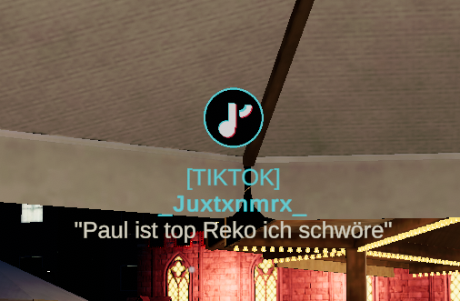
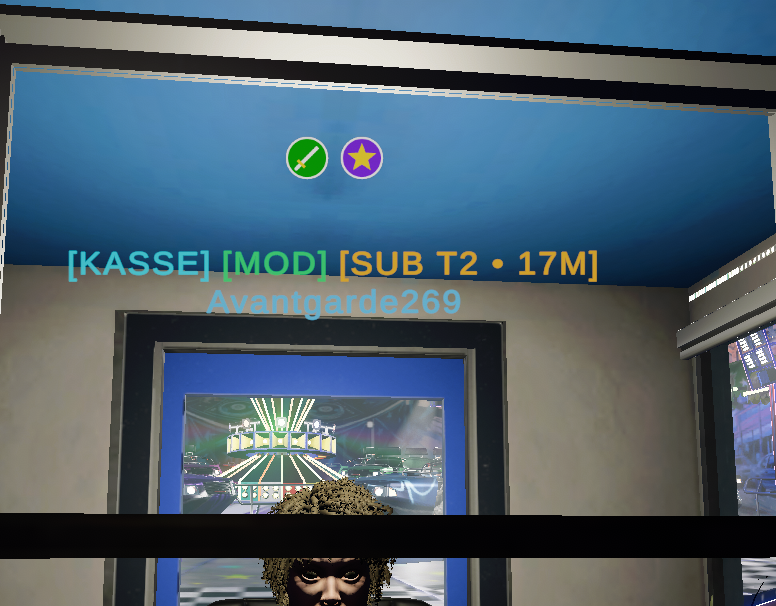
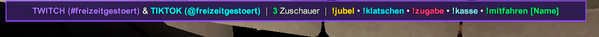
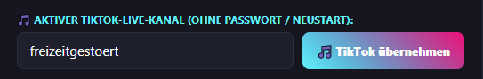
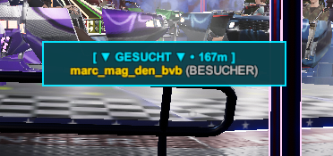
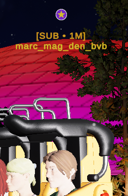
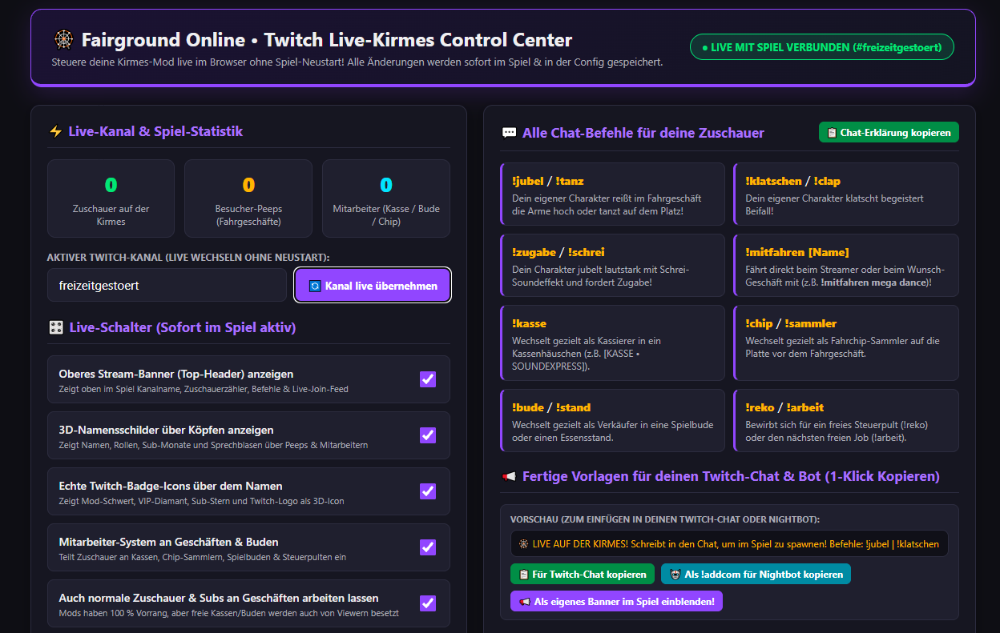
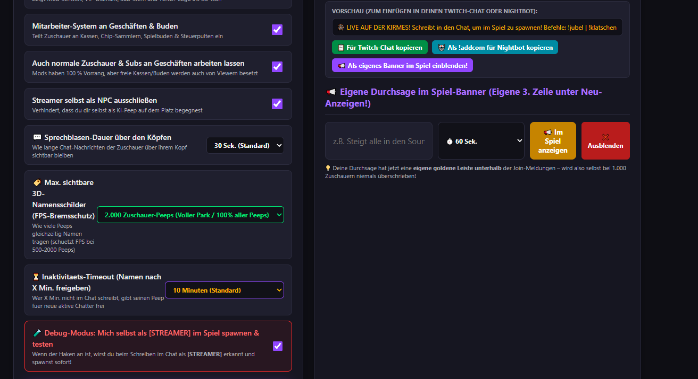
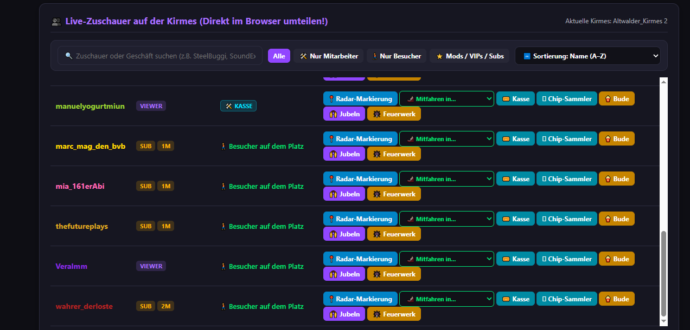

# 🎡 Fairground Online — Fairground Live (Twitch & TikTok Crowd)

<div align="center">

[](https://discord.gg/y7XMy8Jduq)
[](https://github.com/BlackMautz/Fairground-Online-Twitch/releases/latest)
[](#-kein-login--kein-passwort-nötig-100-sicher)

### Verwandle deine Kirmes in ein interaktives Live-Event für Twitch & TikTok!
**Deine Twitch- & TikTok-Zuschauer werden zu echten 3D-Parkbesuchern & Mitarbeitern auf deiner Kirmes.**  
Sie jubeln in Fahrgeschäften mit, bedienen Kassenhäuschen, tragen echte 3D-Badges über dem Kopf und sprechen live über Sprechblasen!

</div>

---

## 🔒 KEIN Login & KEIN Passwort nötig (100 % Sicher)!
> 💡 **Kinderleicht & ohne Risiko:**  
> Du musst dich **weder bei Twitch noch bei TikTok anmelden**, kein Passwort eingeben und keine unsicheren Token erstellen!  
> **Einfach deinen Twitch-Kanalnamen und/oder TikTok-Namen eintragen — FERTIG!**  
> Die Mod liest die Chats völlig anonym und parallel in Echtzeit mit.

---

## 📸 Eindrücke aus dem Spiel (In-Game Screenshots)

<div align="center">

### 🎵 Neu: TikTok & Twitch Multistreaming & 3D-Badges
<p align="center">
  
  
</p>
<i>Links: Echter TikTok-Chatter spawnt mit schwebendem 3D TikTok-Badge über dem Kopf! • Rechts: Twitch-Moderatoren arbeiten live an Kassen</i>

<br><br>

### 👑 Das neue Multistream In-Game Banner & Join-Feed
<p align="center">
  
  <br><br>
  
</p>
<i>Oben: Elegantes, zentriertes Multistream-Banner mit Twitch (#kanal) & TikTok (@kanal), Live-Zuschauerzähler und Befehlen • Unten: Automatische Beitritts-Meldungen im Spiel</i>

<br><br>

### 🎯 Radar-Tracker (Zuschauer durch Wände finden) & Fahrgeschäfte
<p align="center">
  
  <br>
  
</p>
<i>Oben: Radar-Markierung mit Pfeil und Entfernungs-Anzeige • Unten: Zuschauer fahren aktiv in den Attraktionen mit</i>

</div>

---

## 🌐 Das Live Web-Dashboard (Steuerung im Browser ohne Neustart)

Die Mod bringt einen eigenen kleinen Webserver mit (**http://127.0.0.1:48888**), der sich beim Spielstart automatisch öffnet. Hier steuerst du alles live:

<div align="center">

<p align="center">
  
</p>

### 🎛️ Alle Funktionen auf einen Blick:
<p align="center">
  
  
</p>

</div>

* **🟣 Twitch & 🎵 TikTok Kanäle:** Direkt im Browser eintragen oder wechseln.
* **👥 Zuschauer-Tabelle:** Zeigt jeden Chatter mit Name, Plattform (`🎵 TikTok` vs `🟣 Twitch`), Rolle und aktuellem Geschäft.
* **🛠️ 1-Klick Zuweisung:** Klicke bei einem Zuschauer auf `[🎟️ Kasse]`, `[🪙 Chip]`, `[🍿 Bude]` oder `[🎢 Mitfahren in...]`, um ihn sofort dorthin zu teleportieren!
* **📍 Radar-Markierung:** Markiere einen Zuschauer – ein blaues Radar-Zeichen zeigt dir im Spiel genau, wo er gerade steht oder mitfährt!

---

## 💬 Alle Chat-Befehle für deine Zuschauer

Deine Zuschauer auf **Twitch** und **TikTok** können folgende Befehle in deinen Chat schreiben:

| Befehl | Alternative | Funktion |
| :--- | :--- | :--- |
| `!jubel` | `!tanz`, `!handsup` | Hebt im Fahrgeschäft begeistert die Arme hoch oder tanzt auf dem Platz! |
| `!klatschen` | `!clap` | Klatscht begeistert Beifall für die Show oder Fahrt! |
| `!zugabe` | `!schrei`, `!again` | Jubelt lautstark mit Schrei-Soundeffekt und fordert Zugabe! |
| `!mitfahren [Name]` | `!ride [Name]` | Steigt gezielt in ein Fahrgeschäft ein (z.B. `!mitfahren soundexpress` oder `!mitfahren riesenrad`) |
| `!kasse` | `!kassierer` | Bewirbt sich als Kassierer im Kassenhäuschen |
| `!chip` | `!sammler` | Besetzt die Fahrchip-Sammler-Platte vor dem Fahrgeschäft |
| `!bude` | `!stand` | Verkauft Snacks & Lose in Spielbuden und Imbissen |
| `!reko` | `!arbeit` | Besetzt ein Steuerpult (`!reko`) oder den nächsten freien Job |

---

## ⚙️ Installation

1. Installiere zuerst das **[Fairground-Online-BepInEx Framework](https://github.com/BlackMautz/Fairground-Online-BepInEx)**.
2. Lade die neueste **[Fairground Live Release ZIP](https://github.com/BlackMautz/Fairground-Online-Twitch/releases/latest)** herunter.
3. Entpacke den Inhalt (`BepInEx`-Ordner) direkt in dein Spielverzeichnis:
   ```text
   ...\steamapps\common\Fairground Online\
   ```
4. Spiel starten – das Dashboard öffnet sich automatisch im Browser!

---

## 💬 Community & Feedback
Fragen, Ideen oder Wünsche?  
👉 **[Tritt unserer Discord-Community bei: discord.gg/y7XMy8Jduq](https://discord.gg/y7XMy8Jduq)**
